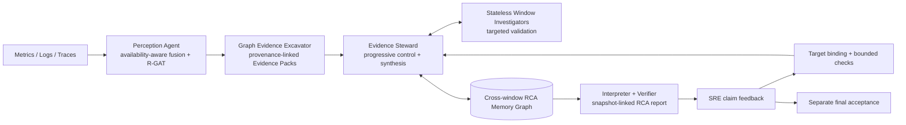

<div align="center">

# Root-Teller

### Progressive Root Cause Analysis in Microservice Systems via a Cross-Window Memory Graph

[](https://www.python.org/)
[](https://pytorch.org/)
[](docs/PAPER_CODE_ALIGNMENT.md)
[](system/README.md)

Availability-aware perception · progressive investigation · cross-window memory · claim-targeted SRE feedback

</div>

Root-Teller analyzes metrics, logs, and traces to localize microservice root
causes. A stateful Evidence Steward coordinates stateless Window Investigators
and maintains an RCA Memory Graph (RMG). Evidence provenance, window access,
hypotheses, validation outcomes, and operator feedback remain inspectable
throughout the investigation.

The current implementation includes bounded non-adjacent cross-window context
and structured feedback refinement: bind a comment to a claim, perform targeted
checks, synthesize a fresh diagnosis, and regenerate a verified report. Supporting
a claim is distinct from accepting the final diagnosis. Earlier evidence is not
deleted when an operator challenges a hypothesis.

## Product demonstration

Watch the demonstration of progressive investigation,
cross-window memory, and claim-targeted feedback. It combines conceptual
illustrations with recorded investigation/feedback replays.

https://github.com/user-attachments/assets/4aa7b3e2-2d73-4ef6-a4a0-02552e76cc45

[Download the original MP4](docs/media/root-teller-product-demonstration.mp4)
or [run the local interactive system](system/README.md).

## Quick start

Python 3.12 is the tested runtime. From a clone of this repository on Windows:

```powershell
py -3.12 -m venv .venv
.\.venv\Scripts\Activate.ps1
python -m pip install --upgrade pip
python -m pip install -e ".[logs,test,system]"

# Directory containing your locally installed benchmark data.
$env:ROOTTELLER_WORKSPACE = "D:\path\to\your\workspace"
.\system\start.ps1 -Workspace $env:ROOTTELLER_WORKSPACE -Port 4315
```

Open <http://127.0.0.1:4315/> and inspect a supported case path or upload a ZIP
archive. Raw benchmark data is not bundled. The UI ships small historical
Perception Agent checkpoints, so the demonstration does not require training
first. Log embeddings may require an installed or downloaded embedding model.
See [supported inputs and setup](system/README.md).

Without a configured API client, the system uses a labelled deterministic /
offline typed-evidence path. This checks pipeline behavior, not LLM effectiveness.
To enable live agents, configure the backend and select live execution in the UI:

```powershell
$env:ROOTTELLER_API_KEY = "your-api-key"
$env:ROOTTELLER_API_BASE = "https://your-endpoint.example/v1"
.\system\start.ps1 -Workspace $env:ROOTTELLER_WORKSPACE -Port 4315
```

Live inference can incur API charges. Keep credentials in the environment, not
in tracked files; runtime outputs are ignored by Git. The model defaults and
execution labels are recorded with each run. See [system configuration](system/README.md).

## Method and implementation



| Component | Source | Current behavior |
|---|---|---|
| Perception | [`module1`](src/root_teller/module1/) | Multimodal encoding, availability-aware fusion, R-GAT; historical and fine-interval configurations |
| Progressive RCA | [`module2`](src/root_teller/module2/) | Evidence Packs, requested historical access, Steward/Investigator coordination |
| Cross-window memory | [`cross_window.py`](src/root_teller/module2/cross_window.py) | Bounded non-adjacent associations from activated windows, with provenance; associations are not causal proof |
| Structured feedback | [`session.py`](src/root_teller/module3/session.py), [`structured`](src/root_teller/module3/structured/) | Claim/window/version binding, receipts, idempotency, transaction rollback, separate acceptance |
| Refinement | [`refinement`](src/root_teller/module3/refinement/) | Targeted checks, fresh evidence-grounded synthesis, snapshot/report regeneration |
| Interactive system | [`system`](system/) | FastAPI and browser UI using the library workflow |

The [revision reference configuration](configs/revision2_method.json) records
one-second aggregation inside 60-second RCA windows, bounded cross-window
context, feedback/task budgets, and scoring settings. It is a readable reference,
not an automatically loaded all-in-one launcher. Runtime options are described
by each entry point's `--help`. The full [paper-to-code map](docs/PAPER_CODE_ALIGNMENT.md)
distinguishes current mechanisms from historical controls and outputs.

## Evaluation workflows

Install the public RCAEval RE2-OB/RE2-TT and Eadro-SN datasets separately and
follow the [workspace and frozen split protocol](evaluation/rq1/README.md).
Keep run directories, private labels, API caches, and predictions local.

### Overall localization (RQ1)

The retained three-seed runners reproduce the **historical preprocessing
configuration**, not an automatically retrained one-second revision:

```powershell
python -m root_teller.multidataset.rq1_three_seed --stage all --dataset re2_ob --seed 41
python -m root_teller.multidataset.rq1_three_seed --stage all --dataset re2_tt --seed 41
python -m root_teller.multidataset.rq1_three_seed --stage all --dataset eadro_sn --seed 41
# Repeat with seeds 42 and 43, then aggregate completed runs.
python -m root_teller.multidataset.rq1_three_seed --stage aggregate
python -m root_teller.multidataset.verify_rq1_three_seed
```

The [baseline adapters](evaluation/rq1/baseline_adapters/README.md) cover Eadro,
Nezha, Multi-source RCD, TORAI, ThinkFL, RCLAgent, RCACopilot, and RCAgent.
For the two added adaptations, start with telemetry preparation (no LLM calls):

```powershell
python -m pip install -e ".[baselines]"
python -m root_teller.baselines.run --method rcacopilot --dataset re2_ob --fold 0 --split validation --mode prepare --output runs/rcacopilot-prepare
```

Use explicit model and budget settings for live evaluation. See [adaptation
provenance and limits](baselines/REPRODUCTIONS.md); historical model identities
must not be inferred from the current defaults.

### Missing telemetry, progressive access, and feedback

- [Telemetry-unavailability generation](tools/telemetry_unavailability/README.md):
GMO/IAMI views and their [evaluation path contract](evaluation/rq2/README.md).
- [Interactive progressive access](system/README.md): `default` uses the full
predefined observation range; `blind` activates earlier windows on request.
Non-adjacent context is restricted to activated history.
- [Paired feedback evaluation](evaluation/feedback/README.md): frozen common T0,
separate private evaluator labels, full/flat/single-agent controls, Top-5,
downweighting, revisit, and no-feedback reference. Success within budget is
reported separately from capped interaction cost.

```powershell
python -m root_teller.module3.evaluate_feedback --help
python -m root_teller.baselines.run --help
python tools/telemetry_unavailability/prepare.py --help
```

## Tests and release checks

Run from the repository root after installation:

```powershell
python -m pytest -q
python evaluation/rq1/scripts/verify_artifact.py
root-teller audit-release --release-root . --output-dir docs/audit
```

Tests cover cross-window access/provenance, temporal slicing, structured
feedback, model-client orchestration, rollback, duplicate submissions, separate
final acceptance, interaction accounting, API integration, and repository
documentation links. Data/cache-dependent checks skip when their fixtures are
unavailable. These tests do not call paid models or validate benchmark accuracy.
[System validation](system/VALIDATION.md) separates current synthetic checks
from historical live-model and browser records.

## Repository guide

| Path | Contents |
|---|---|
| [`src/root_teller`](src/root_teller/) | Installable perception, RCA, feedback, and baseline packages |
| [`system`](system/README.md) | Local UI/API, launcher, historical small checkpoints |
| [`evaluation`](evaluation/README.md) | Split manifests, evaluator/adapters, feedback protocol, result provenance |
| [`configs`](configs/) | Historical frozen settings and revision reference configuration |
| [`baselines`](baselines/README.md) | Upstream provenance, permitted snapshots, adaptation boundaries |
| [`tools/telemetry_unavailability`](tools/telemetry_unavailability/README.md) | Missing-telemetry view generator and semantic checks |
| [`tests`](tests/) | Self-contained contracts and optional local-data tests |
| [`CHANGELOG.md`](CHANGELOG.md) | Implementation and documentation changes |



## License and data

Root-Teller-authored code is distributed under the repository [MIT license](LICENSE).
Third-party snapshots retain their upstream terms; see [baseline provenance](baselines/README.md)
and the [third-party status notice](evaluation/rq1/baseline_adapters/THIRD_PARTY_STATUS.md).
Eadro implementation code is not redistributed here. RCAEval and Eadro-SN data
must be obtained from their original providers under their applicable terms.
No benchmark telemetry, credentials, private labels, or model-response caches
are provided with this code release.

